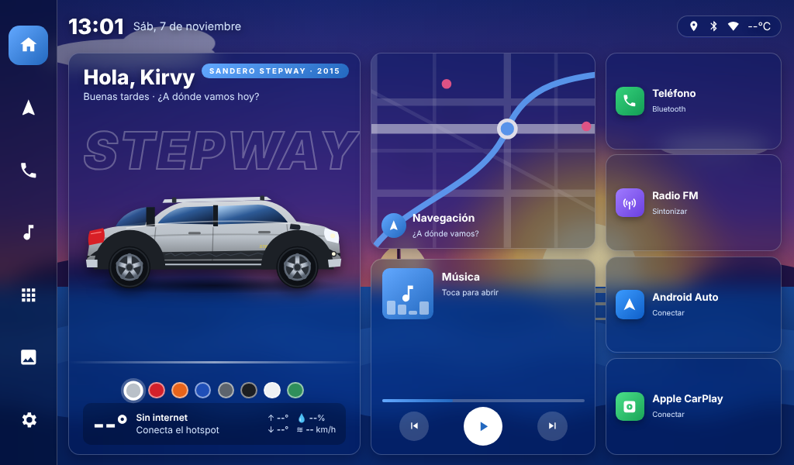

# Stepway Launcher

Pantalla de inicio para el radio Android (1024x600) de la Renault Stepway 2015:
saludo con nombre, Stepway naranja, reloj, clima en vivo, navegación, música,
teléfono, radio FM, Android Auto y Apple CarPlay.

## Cómo obtener el APK (sin instalar nada en tu PC)
1. Crea un repositorio nuevo en GitHub (por ejemplo `stepway-launcher`).
2. Sube TODO el contenido de esta carpeta (incluida la carpeta oculta `.github`).
   - Más fácil: en el repo, "Add file > Upload files" y arrastra las carpetas.
   - Si la carpeta `.github` no se sube por arrastre, créala a mano:
     "Add file > Create new file" con nombre `.github/workflows/build.yml`
     y pega el contenido de ese archivo.
3. Ve a la pestaña **Actions**. Se compila solo (unos 5 minutos).
4. Abre la ejecución terminada y descarga **StepwayLauncher-APK** (es un .zip con el .apk).

Alternativa: abre la carpeta en Android Studio y usa Build > Build APK.

## Instalar en el radio
1. Copia `StepwayLauncher.apk` a una USB (FAT32) y conéctala al radio.
2. Abre el administrador de archivos del radio y toca el APK.
   Si pide permiso para "orígenes desconocidos", actívalo para ese administrador.
3. Presiona el botón HOME y elige **Stepway Launcher > Siempre**.
   O: Ajustes > Aplicaciones > Apps predeterminadas > App de inicio.
4. Acepta el permiso de ubicación (es para el clima).

## Uso
- **Toque corto** en un botón: abre la app.
- **Toque largo** (1 segundo) en cualquier botón: eliges qué app abre
  (útil para la app de Bluetooth/radio de tu equipo, ZLink o AutoKit). Se guarda.
- Toca "Hola, Kirvy" para cambiar el nombre.
- **Color de la Stepway**: toca los círculos de color debajo de la camioneta
  (Plata, Rojo Fuego, Naranja Cobre, Azul Cosmos, Gris, Negro, Blanco, Verde).
  Todo el tema (botones, mapa, música) cambia al mismo color. Se guarda.
- Toca la camioneta para verla "arrancar".
- **Fondo**: botón de imagen en la barra izquierda.
  "Elegir foto" abre tu galería/USB: pon la imagen que quieras.
  "Atardecer en el mar" vuelve al fondo animado.
  "Usar foto de MI carro" cambia el dibujo por una foto tuya (se ve mejor
  en PNG sin fondo; puedes quitarle el fondo gratis en remove.bg).
  "Volver al dibujo" regresa la Stepway dibujada.
- Botón de cuadritos: todas las apps. Engrane: ajustes de Android.

## Personalizar
- Colores disponibles: lista `COLORES` en `app/src/main/assets/launcher/index.html`.
- Apps por defecto: lista `DEFAULTS` en el mismo archivo.

## Volver al launcher original
Ajustes > Aplicaciones > Apps predeterminadas > App de inicio > el original.
O desinstala Stepway Launcher.
